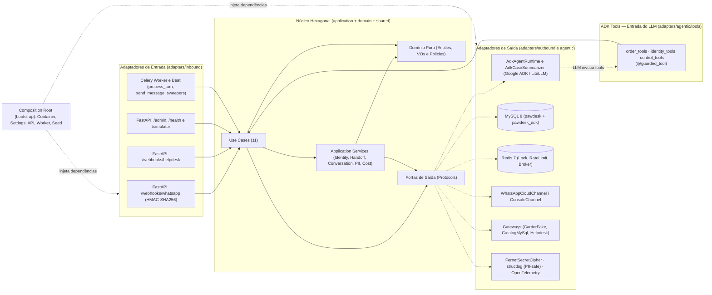
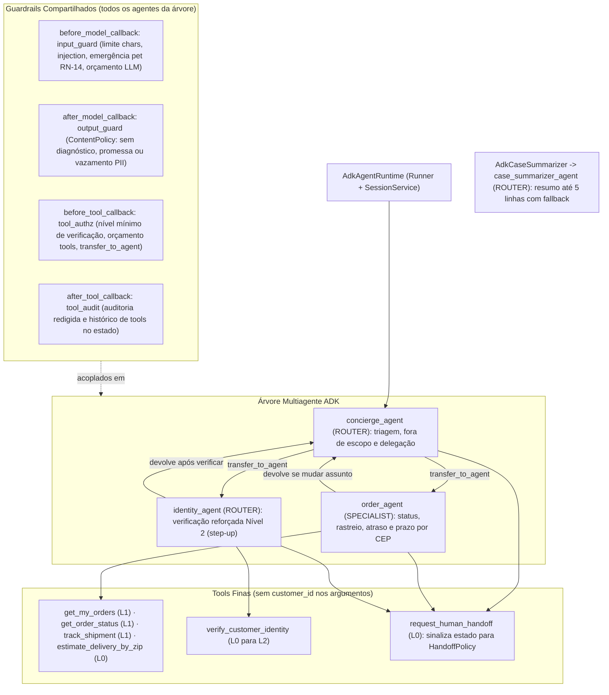
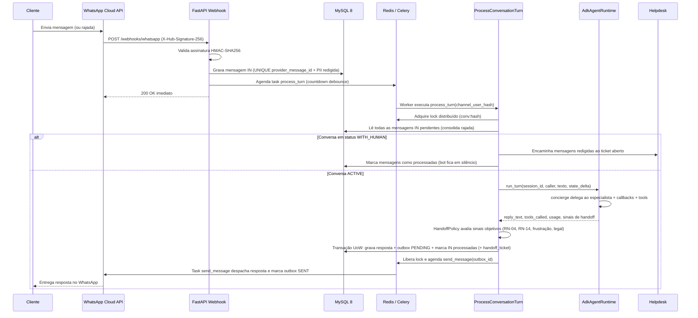
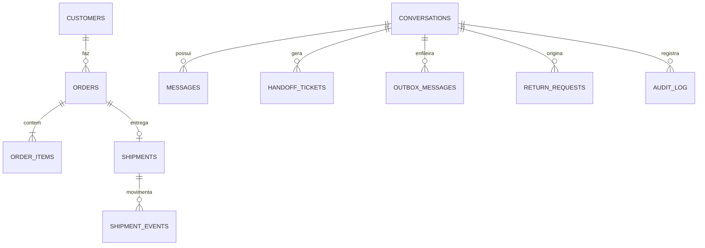

# PawDesk 🐾

Agente conversacional de IA para atendimento ao cliente de e-commerce pet via WhatsApp, construído com **Google ADK**, **Arquitetura Hexagonal** (`import-linter`) e processamento assíncrono (**FastAPI + Celery + Redis + MySQL 8**).

## Documentação

- [Documento de Produto (Negócio)](docs/01-negocio-produto.md)
- [Documento Técnico de Arquitetura](docs/02-tecnico-arquitetura.md)

---

## Escopo Implementado (MVP Fases 0 a 4)

- **UC-01**: Consulta de pedidos recentes, status detalhado, rastreamento e detecção automática de atraso (RN-04: > 3 dias úteis → handoff).
- **UC-02**: Estimativa de prazo e frete por CEP + SKU via catálogo e gateway de transportadora (RN-03: sem estimativa pelo LLM).
- **UC-07**: Handoff humano com política objetiva (`HandoffPolicy`), resumo mascarado (≤ 5 linhas via `case_summarizer_agent`), abertura de ticket no helpdesk, silenciamento automático do bot (`WITH_HUMAN`), encaminhamento de novas mensagens e retomada via webhook do helpdesk.
- **UC-08 & Segurança**: Proteção em dois níveis (RN-01 `PHONE_MATCH` e `STEP_UP`), anti-IDOR no use case (RN-02), guardrails de entrada/saída (`input_guard`, `output_guard`, `tool_authz`, `tool_audit`), resposta segura em emergências veterinárias (RN-14), redação de PII em logs/mensagens e rota administrativa de anonimização LGPD (RN-17).

---

## Arquitetura Hexagonal (Visão de Componentes e Fronteiras)

As dependências entre camadas são verificadas automaticamente no CI via `import-linter` (4 contratos ativos: camadas hexagonais, núcleo livre de frameworks, `shared` folha pura e adaptadores independentes entre si).



---

## Componentes da Camada Agêntica (Google ADK)

O `AdkAgentRuntime` atua com "dupla face": é chamado pelo núcleo como porta de saída (`AgentRuntime`) e volta ao núcleo pelas *tools* finas (adaptadores de entrada). Todos os agentes da árvore compartilham os mesmos callbacks de segurança e orçamento por turno.



---

## Fluxo Assíncrono Ponta a Ponta (Inbox, Debounce, Lock, Outbox e Handoff)



---

## Modelo de Dados (MySQL 8)



> As sessões do Google ADK (`DatabaseSessionService`) ficam isoladas em um schema dedicado (`pawdesk_adk`), fora do controle do Alembic, provisionado automaticamente por [init.sql](docker/mysql/init.sql).

---

## Estrutura Principal

```text
src/pawdesk/
├── shared/        # Constantes e utilitários puros (stdlib)
├── domain/        # Entidades, Value Objects e políticas de negócio puras
├── application/   # Use cases, serviços de coordenação, DTOs e portas (Protocols)
├── adapters/
│   ├── inbound/   # FastAPI (webhooks, simulator, admin, health) e Celery worker/beat
│   ├── agentic/   # Google ADK runtime, agentes, prompts, tools finas e callbacks
│   └── outbound/  # MySQL (SQLAlchemy async), Redis, Celery scheduler, canais, gateways e OTel
└── bootstrap/     # Composition root (Container, Settings, API, Worker, Seed)
```

---

## Ambiente Local e Testes (sem chave de API externa)

```bash
cp .env.example .env
uv sync --extra dev

# Lint, tipagem estática e contratos hexagonais
uv run ruff check .
uv run mypy src
uv run lint-imports

# Testes unitários, agentes ADK (ScriptedFakeLlm), contrato (memória + SQLite) e E2E
uv run pytest tests/unit tests/agents tests/e2e tests/contract tests/integration -m "not integration" -v
```

## Stack Completa com Docker Compose (MySQL 8 + Redis + API + Celery + Beat)

```bash
make up
make migrate
make seed
curl http://localhost:8000/health/ready
make chat
```

Personas sintéticas disponíveis após o seed:
- **Marina** (`+5511999990001`, CPF final `456`): pedido `PD-104822` em rota de entrega hoje e `PD-104510` entregue.
- **Carlos** (`+5511999990002`, CPF final `789`): pedido `PD-104901` em separação.
- **Bia** (`+5511999990003`, CPF final `321`): pedido `PD-104300` atrasado > 3 dias úteis (dispara handoff RN-04) e `PD-104750` com atraso leve.

Para subir a UI visual do Google ADK (`adk web`) usando dados em memória (requer chave de API configurada no `.env`):

```bash
make adk-web
```
