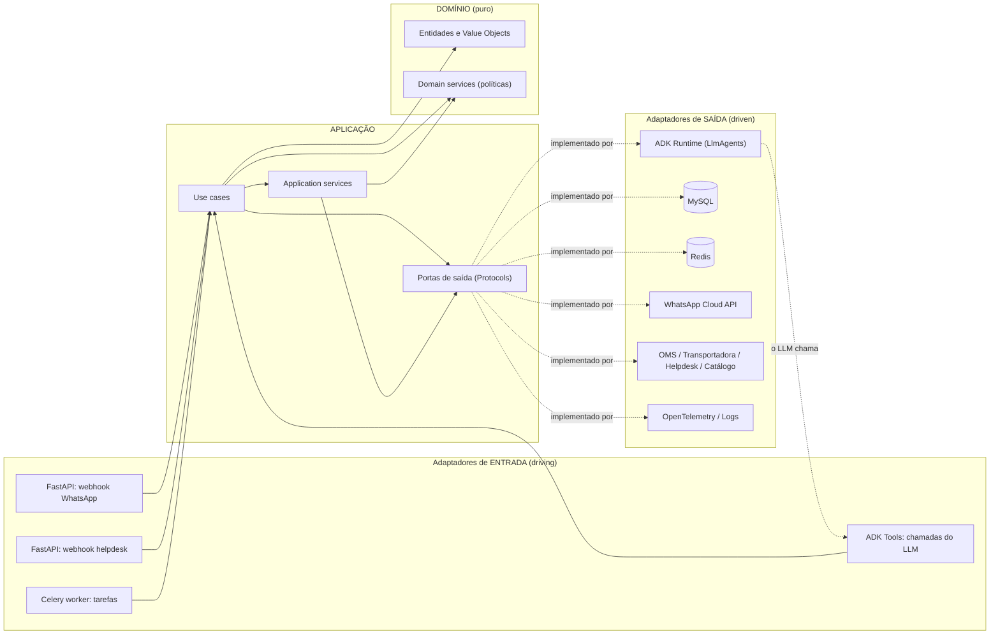

# PawDesk — Documento Técnico de Arquitetura

> Agente de atendimento para e-commerce pet via WhatsApp, construído com **Google ADK**, **arquitetura hexagonal**
> e processamento assíncrono. Complementa o documento de negócio (`01-negocio-produto.md`).
>
> Os trechos de código são **ilustrativos** (mostram intenção e contratos). Antes de implementar, confirme as
> assinaturas na versão do ADK que você fixar (ver seção 15).

## Sumário

1. [Objetivo e requisitos técnicos](#1-objetivo-e-requisitos-técnicos)
2. [Stack e decisões de arquitetura (ADRs)](#2-stack-e-decisões-de-arquitetura-adrs)
3. [Arquitetura hexagonal aplicada](#3-arquitetura-hexagonal-aplicada)
4. [Estrutura de pastas](#4-estrutura-de-pastas)
5. [Arquitetura de agentes e subagentes](#5-arquitetura-de-agentes-e-subagentes)
6. [Tools](#6-tools)
7. [Domínio, portas, use cases e services](#7-domínio-portas-use-cases-e-services)
8. [Utils e constantes](#8-utils-e-constantes)
9. [Fluxo assíncrono: FastAPI, Celery e Redis](#9-fluxo-assíncrono-fastapi-celery-e-redis)
10. [Persistência (MySQL)](#10-persistência-mysql)
11. [Observabilidade, avaliação e testes](#11-observabilidade-avaliação-e-testes)
12. [Segurança e LGPD](#12-segurança-e-lgpd)
13. [Docker, configuração e ambiente](#13-docker-configuração-e-ambiente)
14. [Roadmap de implementação](#14-roadmap-de-implementação)
15. [Riscos técnicos e pontos a validar](#15-riscos-técnicos-e-pontos-a-validar)

---

## 1. Objetivo e requisitos técnicos

### 1.1 Requisitos funcionais (resumo)
Atender UC-01 a UC-08 do documento de negócio: status/rastreio, prazo, troca/devolução com confirmação,
2ª via de NF e boleto/PIX, dúvidas de produto e handoff humano.

### 1.2 Requisitos não funcionais

| Requisito | Meta | Como a arquitetura atende |
|---|---|---|
| **Latência** | Webhook responde em < 1 s; resposta ao cliente p95 < 15 s | Webhook só enfileira; modelo pequeno no roteador; tools rápidas |
| **Confiabilidade** | Nenhuma mensagem perdida ou processada 2x | Inbox transacional (`UNIQUE` em `message_id`), `acks_late`, outbox para envio |
| **Ordem** | Mensagens da mesma conversa em ordem | Lock por conversa + *debounce* de mensagens em rajada |
| **Segurança** | Cliente só vê os próprios dados | Identidade no estado da sessão, nunca em argumento da tool |
| **Testabilidade** | Regras de negócio testáveis sem LLM, banco ou rede | Hexagonal: domínio puro e portas com *fakes* |
| **Observabilidade** | Rastrear cada turno: agente, tool, tokens, custo | OpenTelemetry + logs estruturados + métricas |
| **Trocabilidade** | Trocar LLM, canal ou helpdesk sem tocar no núcleo | Portas e adaptadores |
| **Custo** | Controlar custo por conversa | Roteamento de modelos, limites por turno, métricas de custo |

---

## 2. Stack e decisões de arquitetura (ADRs)

### 2.1 Stack

| Camada | Tecnologia | Papel |
|---|---|---|
| Linguagem | **Python 3.12** | `StrEnum`, `Protocol`, `asyncio` |
| Orquestração de agentes | **Google ADK** (`google-adk`) | Agentes, subagentes, tools, sessões, callbacks, eval |
| LLMs | **Anthropic** e/ou **OpenAI** via `LiteLlm` (adapter do ADK) | Provedor configurável por agente |
| API | **FastAPI** + Uvicorn | Webhooks e endpoints administrativos |
| Assíncrono | **Celery** + **Redis** | Fila, retentativas, locks, idempotência |
| Banco | **MySQL 8** + SQLAlchemy 2 (async) + Alembic | Domínio simulado, conversas, outbox, sessões ADK |
| Contêineres | **Docker** + Docker Compose | Ambiente reproduzível |
| Observabilidade | OpenTelemetry, structlog, Datadog (opcional) | Traces, logs e métricas |
| Qualidade | pytest, ruff, mypy, import-linter | Testes e regras de dependência |
| Config | pydantic-settings | Configuração tipada por ambiente |

### 2.2 ADRs resumidos

| # | Decisão | Motivo | Consequência |
|---|---|---|---|
| ADR-01 | **ADK como framework de agentes** | Multiagente por hierarquia, tools, sessões, callbacks e `adk eval` nativos | Dependência de um framework em evolução → isolar atrás de uma porta |
| ADR-02 | **LangChain/LangGraph fora do núcleo** | Dois orquestradores competindo geram complexidade. ADK cobre o caso | Se necessário, um fluxo determinístico complexo pode virar um subgrafo LangGraph exposto como *tool* |
| ADR-03 | **Hexagonal com o ADK como adaptador** | Regras de negócio não podem depender de framework de IA | `domain/` e `application/` não importam `google.adk` |
| ADR-04 | **Tools são adaptadores de entrada finos** | O agente "dirige" a aplicação, como um controller | Toda regra fica em use cases/domínio, nunca na tool |
| ADR-05 | **Identidade vem do estado da sessão, não do LLM** | Evita que prompt injection acesse dados de terceiros | Nenhuma tool recebe `customer_id` como parâmetro |
| ADR-06 | **Agente sinaliza, aplicação decide e executa efeitos de controle** | Handoff e envio de mensagem devem ser atômicos e auditáveis | Agente grava sinais no estado; o use case age |
| ADR-07 | **Confirmação determinística para ações** | O LLM não pode "confirmar" por conta própria | Confirmação vem de payload de botão do WhatsApp |
| ADR-08 | **Webhook só enfileira** | Provedores reenviam se a resposta demora | Processamento em Celery com idempotência |
| ADR-09 | **Modelos em camadas** | Reduz custo/latência | Roteador com modelo pequeno, especialistas com modelo médio |

---

## 3. Arquitetura hexagonal aplicada

### 3.1 Ideia central

O **núcleo** (domínio + aplicação) define *o que* o sistema faz e *do que precisa* (portas). Tudo que é tecnologia
(HTTP, fila, banco, WhatsApp, LLM) fica nas bordas como **adaptadores**.

O ponto mais sutil deste projeto: o **agente ADK tem "dupla face"**.

| Face | Papel hexagonal | Onde fica |
|---|---|---|
| **Runtime do agente** (`Runner`, agentes, callbacks) | **Adaptador de saída** — implementa a porta `AgentRuntime` que o use case `ProcessConversationTurn` chama | `adapters/agentic/runtime.py` |
| **Tools** (funções chamadas pelo LLM) | **Adaptadores de entrada** — traduzem a chamada do LLM em um comando e invocam um use case | `adapters/agentic/tools/` |

Ou seja: o núcleo chama o agente (saída) e o agente, por meio das tools, volta a chamar o núcleo (entrada).
Isso mantém as regras de negócio no mesmo lugar, independentemente de quem as aciona (LLM, HTTP, CLI, teste).

### 3.2 Diagrama



### 3.3 Regras de dependência

```
bootstrap  →  adapters  →  application  →  domain          (setas = "pode importar")
shared (utils/constants) é folha: não importa nada do projeto
```

| Camada | Pode importar | **Não** pode importar |
|---|---|---|
| `domain` | `shared`, stdlib | `application`, `adapters`, ADK, FastAPI, Celery, SQLAlchemy, Redis, LiteLLM |
| `application` | `domain`, `shared`, stdlib | `adapters`, ADK, FastAPI, Celery, SQLAlchemy, Redis, LiteLLM |
| `adapters/inbound` | `application`, `domain`, `shared`, libs de framework | `adapters/outbound`, `adapters/agentic` |
| `adapters/agentic` | `application`, `domain`, `shared`, `google.adk` | `adapters/inbound`, `adapters/outbound` |
| `adapters/outbound` | `application`, `domain`, `shared`, libs de infraestrutura | `adapters/inbound`, `adapters/agentic` |
| `bootstrap` | Tudo (é o único que conhece implementações concretas) | — |

---

## 4. Estrutura de pastas

```
pawdesk/
├── pyproject.toml
├── Makefile
├── Dockerfile
├── docker-compose.yml
├── .env.example
├── README.md
├── docs/
│   ├── 01-negocio-produto.md
│   └── 02-tecnico-arquitetura.md
├── migrations/
├── evals/
├── adk_dev/
├── tests/
└── src/pawdesk/
    ├── shared/
    ├── domain/
    ├── application/
    ├── adapters/
    └── bootstrap/
```
